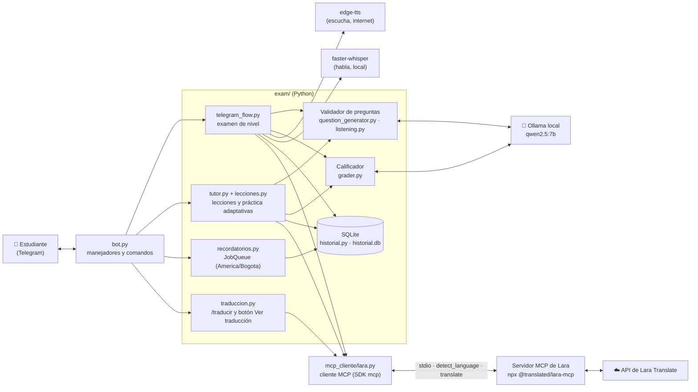
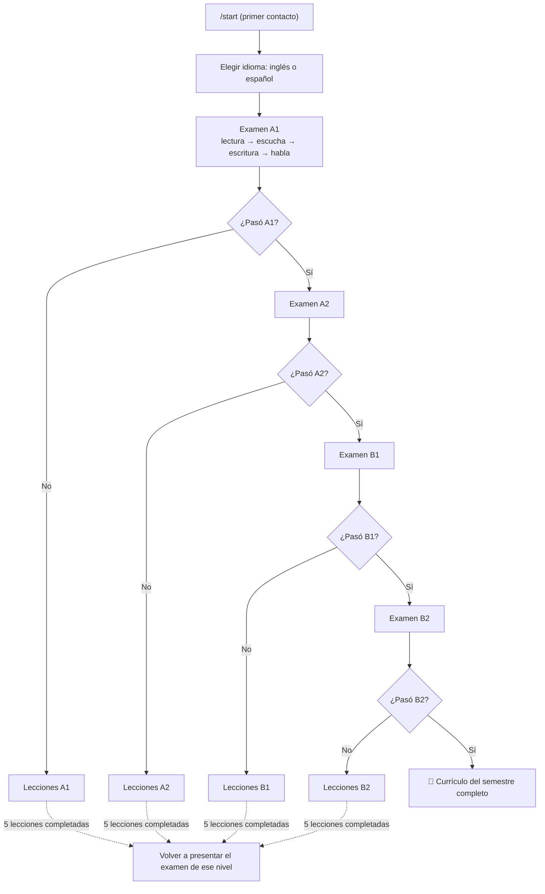

# Tutor Inteligente de Idiomas (Telegram Bot)

Proyecto de la materia **Sistemas Inteligentes**. Es un chatbot de Telegram que funciona como tutor de idiomas personalizado (similar a Duolingo) para **inglés y español**.

Al primer contacto, el usuario presenta un **examen de nivel** con cuatro partes: **lectura, escucha, escritura y habla**. El examen decide su nivel de partida (A1 a B2). Después, el tutor le da **lecciones y ejercicios generados en vivo** para su nivel, se adapta a sus aciertos y errores, guarda su progreso y le manda **recordatorios de estudio**.

> El tutor es una herramienta de apoyo al aprendizaje: no reemplaza a un docente ni equivale a una certificación oficial.

## Documentación (wiki)

- [PEAS y tipo de agente](https://github.com/DaniTap02/Tutor-idiomas-bot/wiki/PEAS-y-tipo-de-agente)
- [Niveles y currículo](https://github.com/DaniTap02/Tutor-idiomas-bot/wiki/Niveles-y-curr%C3%ADculo)
- [Diseño del examen inicial](https://github.com/DaniTap02/Tutor-idiomas-bot/wiki/Dise%C3%B1o-del-examen-inicial)
- [Arquitectura técnica](https://github.com/DaniTap02/Tutor-idiomas-bot/wiki/Arquitectura-t%C3%A9cnica)
- [Roles del equipo](https://github.com/DaniTap02/Tutor-idiomas-bot/wiki/Roles-del-equipo)

## Estado del proyecto

- [X] **Fase 0:** diseño y fundamentos
- [X] **Fase 1:** esqueleto del bot
- [X] **Fase 2:** examen de nivel A1, A2, B1 y B2 con las cuatro partes, en inglés y español
- [X] **Fase 3:** tutor adaptativo (lecciones y práctica generadas en vivo), MCP de Lara Translate e historial en SQLite
- [ ] **Fase 4:** recordatorios, pulido y evaluación final. 🧪 **En pruebas:** el código está completo y pasa las pruebas sin Ollama; falta probarlo con Ollama y Telegram reales y medir con usuarios.

## Diseño del agente (resumen PEAS)

**Tipo de agente:** basado en utilidad, con aprendizaje. No sigue reglas fijas: evalúa el desempeño del usuario y cambia lo que hace después (qué tema repasa, cuándo avanza y cuándo le ofrece volver a presentar el examen) según el historial que va guardando.

| Elemento | Descripción |
|---|---|
| **Entorno** | Chat de Telegram. El usuario interactúa por texto, botones y notas de voz. |
| **Desempeño** | Nivel inicial correcto, contenido acorde al nivel, retroalimentación de errores, dificultad adaptativa, recordatorios y registro del progreso. |
| **Sensores** | Mensajes de texto, notas de voz (transcritas en local), botones de respuesta, idioma detectado (Lara), horario de recordatorios e historial en SQLite. |
| **Actuadores** | Aplicar el examen, asignar y actualizar el nivel, generar lecciones y ejercicios, calificar respuestas abiertas, traducir, repetir temas fallados, registrar el progreso y enviar recordatorios. |

**Métricas de éxito** (`python -m exam.metricas`):
- precisión del examen inicial;
- porcentaje de errores que no se repiten tras la retroalimentación;
- aciertos por tema y avance por nivel;
- tasa de retorno después de un recordatorio;
- preguntas anuladas por tipo.

**Propiedades del entorno:** parcialmente observable, estocástico, secuencial, dinámico, discreto y de agente único.

## Arquitectura



Hay **dos agentes con responsabilidades separadas**, que solo comparten el modelo de Ollama y el criterio de nivel:

| | **Validador de preguntas** | **Calificador de respuestas** |
|---|---|---|
| Archivos | `question_generator.py`, `listening.py` | `grader.py` |
| Cuándo actúa | **antes** de que el estudiante vea una pregunta (examen, lección o práctica) | cuando el estudiante ya escribió o habló |
| Qué decide | si una pregunta es apta: respuesta única, contexto suficiente, nivel correcto, evidencia citada | si la respuesta abierta cumple la tarea y qué errores tiene |
| Qué NO hace | no ve respuestas de estudiantes | no arregla preguntas malas |

## El examen de nivel

El examen se detiene en el primer nivel que **no** se aprueba. Si alguien pasa A2 pero no B1, queda en enseñanza de B1. **Aprobar B2 termina el currículo del semestre.**



### Las cuatro partes

| Parte | Qué hace el estudiante | Cómo se califica |
|---|---|---|
| 📖 **Lectura** | Responde 10 preguntas de opción múltiple (gramática, vocabulario y comprensión de textos). | Porcentaje de aciertos. |
| 🎧 **Escucha** | Oye 3 audios cortos y responde con botones. Puede repetir cada audio una vez. | Porcentaje de aciertos. |
| ✍️ **Escritura** | Escribe un texto según la consigna del nivel. | El calificador revisa requisitos y errores. |
| 🎤 **Habla** | Envía una nota de voz según la consigna del nivel. | Se transcribe en local y el calificador revisa el contenido. |

**Aprobar un nivel:** cada parte evaluada debe sacar **al menos 60** y el promedio **al menos 70** (`exam/placement.py`). Si una parte no se puede evaluar (por ejemplo, la escucha falla porque no hay internet), **no se promedia**: nunca se penaliza al estudiante por un fallo del sistema.

### Las preguntas no están escritas a mano

No hay banco pregenerado. **Ollama redacta** cada pregunta en vivo a partir de los temas permitidos del nivel. El **código** elige el tema, baraja las opciones y decide cuál es la correcta. Antes de mostrarse, cada pregunta pasa por tres controles:

1. **Filtros de código** (deterministas): formato, tres opciones distintas y cortas, solo alfabeto latino, largo máximo, palabras prohibidas del nivel, que la respuesta correcta no deje palabras repetidas, que los temas que necesitan contexto lo traigan y que los pronombres con género tengan pista de género. En la escucha, además, nada que solo funcione escrito.
2. **Verificación con el modelo** (temperatura 0): debe haber **exactamente una** opción válida y ser la marcada como correcta; el contexto debe alcanzar y el nivel debe ser el adecuado.
3. **Evidencia citada y comprobada por código**: el modelo tiene que **copiar las palabras** de la pregunta que hacen única la respuesta. Si no puede señalar nada, la pregunta es ambigua y se anula.

| Pregunta | Opciones | Qué pasa |
|---|---|---|
| `My brother is ___ than my sister.` | taller / younger / shorter | se anula: nada dice cuál |
| `My brother is 10 and my sister is 15. My brother is ___ than my sister.` | younger / older / more young | pasa: las edades lo deciden |

Lo que no pasa se **anula**: no se le muestra al estudiante, se registra en `voided_questions.jsonl` y se genera otra. Los mismos controles valen para los ejercicios de las lecciones y de `/practicar`.

```bash
python -m exam.void_report              # por qué se anulan preguntas
python -m exam.void_report listening    # solo la parte de escucha
```

### El calificador juzga el significado

Nunca compara con una respuesta esperada: las tareas de escritura y habla son abiertas. Acepta contracciones, sinónimos, estructuras distintas y variantes regionales. Cuando una respuesta está a medias, dice **qué falta y por qué**. Antes de calificar, **Lara detecta el idioma**: si el texto está claramente en otro idioma, se pide de nuevo sin calificar y sin contar el intento.

### Audio

- **Escucha (texto a voz):** `exam/tts.py` usa [edge-tts](https://pypi.org/project/edge-tts/), que **necesita internet**. `exam/audio.py` convierte el mp3 a nota de voz OGG/OPUS con **PyAV** (no hace falta ffmpeg). Si no se puede generar un audio, se muestra el texto y esa pregunta **no cuenta**.
- **Habla (voz a texto):** `exam/stt.py` usa [faster-whisper](https://pypi.org/project/faster-whisper/) **en local**. La parte de habla califica **lo que se dijo**, no la pronunciación.
- Cada etapa falla con su **motivo real** (`exam/registro.py`): el bot no dice «¿tienes internet?» cuando el problema es otro. Para revisar tu PC: `python -m exam.diagnostico`.

## El tutor adaptativo

Después del examen, el estudiante aprende en su nivel e idioma con `/leccion` y `/practicar` (`exam/tutor.py`).

- **Temario como datos** (`exam/lecciones.py`): **5 lecciones por nivel e idioma**, A1 a B2, inglés y español en espejo (40 en total). Cada lección dice qué temas del banco practica, su objetivo y su tarea de escritura. No hay preguntas escritas a mano.
- **Cada lección:** una mini explicación generada por Ollama (con filtros de alfabeto, largo y gramática del nivel; si falla, un texto de respaldo), luego **ejercicios generados y validados** con el mismo validador del examen y al final **una escritura corta** calificada por `grader.py` (antes pasa por `detect_language`).
- **Adaptación:**
  - si falla un tema, el siguiente ejercicio es del **mismo tema con otra pregunta**;
  - con **3 aciertos seguidos avanza** a la escritura;
  - la lección tiene 5 ejercicios, con un tope de 10 para no dejar al estudiante atascado;
  - `/practicar` repasa más seguido los temas que falló;
  - al completar las 5 lecciones, ofrece **volver a presentar el examen** de ese nivel para subir.
- Los mensajes de lección y práctica van **en el idioma que se estudia**. En A1 y A2 llevan el botón **🌐 Ver traducción**.

## MCP: Lara Translate

**¿Qué es un MCP?** El *Model Context Protocol* es un protocolo abierto para que una aplicación (el **cliente**) use herramientas que expone otro programa (el **servidor**) de forma estándar: el cliente pide la lista de herramientas (`list_tools`) y las llama con argumentos JSON (`call_tool`). El bot es el **cliente MCP** (SDK oficial de Python, paquete `mcp`) y usa el **servidor MCP oficial de Lara Translate** ([translated/lara-mcp](https://github.com/translated/lara-mcp)), que corre en local por *stdio* con `npx`.

**¿Por qué Lara?** Es un servidor MCP oficial y mantenido, tiene plan gratis, traduce entre inglés y español con buena calidad y además detecta el idioma, que es justo lo que le faltaba al tutor. No se agregó ninguna otra API paga.

**Las 2 herramientas que usa el bot** (el servidor expone 22; se listan con `python -m mcp_cliente.probar_lara`):

| Herramienta | Para qué la usa el bot |
|---|---|
| `detect_language` | Antes de calificar una escritura o la transcripción del habla (examen y lecciones), comprueba que esté en el idioma pedido. Si está claramente en otro, pide repetirla **sin calificar ni penalizar**. Si el texto es muy corto (menos de 4 palabras) o Lara no responde, no bloquea: decide el calificador. |
| `translate` | Comando `/traducir <texto>` (del idioma que estudia a su idioma nativo y al revés) y botón **Ver traducción** en A1 y A2 bajo las consignas, las explicaciones y la retroalimentación. |

**Cómo funciona** (`mcp_cliente/lara.py`):
- abre **una sola sesión MCP** durante toda la vida del bot;
- usa tiempo de espera y un reintento corto;
- guarda en caché las traducciones repetidas para no gastar la cuota.

Si Lara no está configurada, no responde o agotó la cuota, el bot sigue funcionando: la detección se salta y `/traducir` responde que la traducción no está disponible. El motivo real queda en el registro (`lara_sin_config`, `lara_credenciales`, `lara_cuota`, `lara_tiempo`, `lara_servidor`...).

**Cómo conseguir las credenciales:**
1. Suscríbete a un plan en [laratranslate.com/pricing](https://laratranslate.com/pricing). El gratis sirve: incluye 10.000 caracteres de API al mes.
2. En [laratranslate.com/account](https://laratranslate.com/account), sección API, crea un **Access Key ID** y su **Secret**. El Secret solo se ve una vez: guárdalo.
3. Ponlos en tu `.env` (mira `.env.example`):
   ```env
   LARA_ACCESS_KEY_ID=...
   LARA_ACCESS_KEY_SECRET=...
   ```
4. Instala **Node.js 22.23.4 o superior** ([nodejs.org](https://nodejs.org), versión LTS). La primera vez, `npx` descarga el servidor solo.

**Cómo probarlo:**
```bash
python -m pytest exam/test_lara.py      # sin internet (sesión MCP simulada)
python -m mcp_cliente.probar_lara       # conexión REAL: lista las herramientas y prueba las dos
```

## Comandos

| Comando | Descripción |
|---|---|
| `/start` | Primera vez: lanza el examen de nivel. Después: menú con tu nivel |
| `/leccion` | Sigue tu lección: explicación, ejercicios y escritura corta |
| `/practicar` | Un ejercicio suelto de tu nivel e idioma |
| `/siguiente` | Otro ejercicio |
| `/nivel` | Tu nivel, idioma y avance en las lecciones |
| `/puntos` | Tu progreso acumulado (no se borra con `/reiniciar`) |
| `/idioma` | Cambia de idioma; si no tienes nivel en ese idioma, primero haces el examen |
| `/traducir <texto>` | Traduce una palabra o frase con Lara |
| `/recordatorio HH:MM` | Recordatorio diario de estudio (hora de Colombia) |
| `/recordatorio off` | Apaga el recordatorio |
| `/reiniciar` | Borra el nivel del idioma actual y repite el examen (el historial se conserva) |
| `/help` | Ayuda de uso |

## Historial y métricas

`exam/historial.py` guarda en **SQLite** (`historial.db`, en el `.gitignore`):
- usuarios y actividad;
- resultados del examen por parte y por nivel;
- cada ejercicio respondido (tema, correcto o no, fecha);
- lecciones completadas;
- errores del calificador por tipo;
- uso de las herramientas de Lara.

Si la base falla, el bot sigue. `exam/metricas.py` calcula las métricas del PEAS:

```bash
python -m exam.metricas
```

Los recordatorios (`exam/recordatorios.py`) usan la **JobQueue** de python-telegram-bot. Se guardan en la misma base, así que sobreviven a un reinicio. El mensaje invita a seguir la lección pendiente, con un botón para abrirla.

## Requisitos

- **Python 3.10 o superior** (probado con 3.13).
- Una cuenta de Telegram y un token de bot creado con [@BotFather](https://t.me/BotFather).
- [**Ollama**](https://ollama.com) corriendo en local con un modelo descargado (por defecto `qwen2.5:7b`):
  ```bash
  ollama pull qwen2.5:7b
  ```
- **Internet** para los audios de la escucha (edge-tts), para Telegram y para Lara. La transcripción del habla y Ollama funcionan sin internet.
- *Opcional:* **Node.js 22.23.4+** y credenciales de Lara para traducción y detección de idioma.

## Instalación

```bash
git clone https://github.com/DaniTap02/Tutor-idiomas-bot.git
cd Tutor-idiomas-bot
python -m venv .venv
.venv\Scripts\Activate.ps1          # Windows (PowerShell); en Linux/macOS: source .venv/bin/activate
pip install -r requirements.txt
```

La primera nota de voz **descarga el modelo de Whisper** (unos 150 MB con `base`).

## Configuración

Copia `.env.example` como `.env` y pon tu token de Telegram (y, si quieres, las credenciales de Lara).

> **Seguridad:** `.env`, `historial.db`, `datos_bot.pkl` y `voided_questions.jsonl` están en `.gitignore`. No los subas ni los compartas. Si el token se expone, revócalo con `/revoke` en @BotFather.

### Variables de entorno opcionales

| Variable | Por defecto | Para qué |
|---|---|---|
| `OLLAMA_MODEL` | `qwen2.5:7b` | Modelo que redacta y califica |
| `OLLAMA_URL` | `http://localhost:11434` | Dirección de Ollama |
| `OLLAMA_NUM_CTX` | `2048` | Tamaño de contexto |
| `OLLAMA_TIMEOUT` | `120` | Segundos de espera por llamada |
| `EXAM_WORKERS` | `1` | Preguntas generadas en paralelo (más de 1 ahoga la RAM) |
| `EXAM_LISTENING_N` | el del nivel (3) | Cuántos audios de escucha; `2` para probar más rápido |
| `EXAM_EXIGIR_EVIDENCIA` | `1` | `0` desactiva la evidencia citada (genera más rápido, deja pasar ambiguas) |
| `EXAM_RESOLVER_A_CIEGAS` | `1` | `0` desactiva el paso en que el modelo resuelve la pregunta sin ver la clave (una llamada menos por pregunta, deja pasar claves equivocadas) |
| `EXAM_VOID_LOG` | `voided_questions.jsonl` | Registro de preguntas anuladas |
| `WHISPER_MODEL` | `base` | `tiny`, `base`, `small`, `medium` |
| `WHISPER_DEVICE` | `cpu` | `cuda` con GPU NVIDIA con VRAM suficiente |
| `WHISPER_COMPUTE` | `int8` | Precisión del modelo de voz |
| `WHISPER_BEAM` | `5` | `1` para transcribir más rápido |
| `TTS_TIMEOUT` / `TTS_INTENTOS` / `TTS_NOTA_VOZ` | `40` / `3` / `1` | Texto a voz |
| `LARA_ACCESS_KEY_ID` / `LARA_ACCESS_KEY_SECRET` | — | Credenciales de Lara (sin ellas no hay traducción) |
| `LARA_MCP_PAQUETE` | `@translated/lara-mcp@2.2.0` | Paquete npm del servidor MCP |
| `LARA_TIMEOUT` / `LARA_INICIO_TIMEOUT` | `15` / `90` | Segundos por llamada / para arrancar el servidor |
| `LARA_MIN_PALABRAS` | `4` | Por debajo no se detecta el idioma (no bloquea) |
| `HISTORIAL_DB` | `historial.db` | Base SQLite del historial y los recordatorios |

El `.env` se carga **antes** de importar los módulos, así que estas variables también se pueden poner ahí.

## Ejecución

```bash
python bot.py
```

Luego abre tu bot en Telegram y escribe `/start`. El bot usa *long polling* y no necesita servidor público.

> El bot **no puede correr en dos computadores a la vez** con el mismo token.

## Pruebas

**Todas las pruebas automáticas corren con pytest sin Telegram, sin internet, sin Ollama y sin Lara.** Simulan el modelo, Telegram y el servidor MCP. Tardan unos segundos:

```bash
python -m pytest
```

| Archivo | Qué prueba |
|---|---|
| `test_validacion.py` / `test_escucha_validacion.py` | Filtros y validación de lectura y escucha |
| `test_calificador.py` | El calificador de escritura y habla |
| `test_audio.py` | Conversión de audio y motivos reales de error |
| `test_flujo.py` | El examen completo simulado (A1 → B2, casos raros) |
| `test_espanol.py` | El examen en español |
| `test_niveles_simulados.py` | Los 4 bancos en los 2 idiomas y las 40 lecciones con un Ollama simulado |
| `test_tutor.py` | Lecciones, adaptación, `/practicar`, `/nivel`, `/idioma` |
| `test_lara.py` | Cliente MCP de Lara: casos normales y de falla |
| `test_historial.py` | SQLite, `/puntos` y métricas |
| `test_recordatorios.py` | `/recordatorio` con la JobQueue real |
| `test_b1.py` / `test_b2.py` | Filtros de palabras prohibidas |

Cada archivo también se puede correr solo: `python -m exam.test_tutor`.

**Con Ollama de verdad** (lentos, miden la calidad real del modelo):

```bash
python -m exam.test_a1
python -m exam.test_a2
python -m exam.test_b1 lectura
python -m exam.test_b2 lectura es
python -m exam.test_es B2
python -m exam.test_escucha B2 es       # además necesita internet (guarda los .mp3 en audio_prueba/)
python -m mcp_cliente.probar_lara       # Lara real (Node.js + credenciales)
```

Más detalles paso a paso en `comandos_terminal.txt`.

## Estructura del proyecto

```
Tutor-idiomas-bot/
├── bot.py                          # Comandos, registro de manejadores y ciclo de vida (Lara, recordatorios)
├── mcp_cliente/
│   ├── lara.py                     # Cliente MCP de Lara: una sesión, detect_language y translate, caché
│   └── probar_lara.py              # Prueba la conexión real con tus credenciales
├── exam/
│   ├── telegram_flow.py            # Examen de nivel: lectura → escucha → escritura → habla
│   ├── question_generator.py       # Genera y VALIDA preguntas de lectura y ejercicios (Ollama)
│   ├── listening.py                # Genera y valida los textos de escucha + configuración por nivel
│   ├── grader.py                   # Agente calificador de escritura y habla (Ollama)
│   ├── tutor.py                    # Tutor adaptativo: /leccion, /practicar, /nivel, /idioma
│   ├── lecciones.py                # Temario: 5 lecciones por nivel e idioma (datos)
│   ├── traduccion.py               # /traducir, botón Ver traducción y revisión del idioma (Lara)
│   ├── historial.py                # Historial en SQLite
│   ├── metricas.py                 # Métricas del PEAS
│   ├── recordatorios.py            # /recordatorio con la JobQueue (America/Bogota)
│   ├── placement.py                # Reglas de aprobación y a qué nivel pasa
│   ├── questions_a1.py … questions_b2.py   # Bancos por nivel: temas, prohibidos, consignas y checklists
│   ├── espanol.py                  # Formas verbales prohibidas por nivel (español)
│   ├── tts.py / stt.py / audio.py  # Texto a voz, voz a texto y conversión de audio
│   ├── registro.py                 # Motivos reales de error, sin secretos
│   ├── diagnostico.py              # Prueba cada componente en tu PC
│   ├── void_report.py              # Resumen de las preguntas anuladas
│   ├── test_*.py                   # Pruebas (ver la sección Pruebas)
│   └── RESUMEN_*.txt               # Alcance de cada nivel y del audio, en texto
├── docs/                           # Borradores de la wiki y guion de la demo
├── requirements.txt
├── pytest.ini
├── comandos_terminal.txt           # Guía de comandos paso a paso
├── .env.example                    # Plantilla del .env
└── README.md
```

### Agregar ejercicios o lecciones

No se escriben preguntas: se agregan **temas**. Un tema nuevo va en `GRAMMAR_TARGETS` / `VOCAB_TARGETS` (y sus `_ES`) del banco del nivel, con su alcance entre paréntesis. Una lección nueva va en `exam/lecciones.py` y nombra sus temas por el inicio del texto. `test_tutor.py` comprueba que existan en el banco.

## Hoja de ruta

- [X] Examen de nivel con lectura, escucha, escritura y habla (A1–B2, inglés y español).
- [X] Validación de preguntas: nada ambiguo, fuera de nivel o sin contexto llega al estudiante.
- [X] Notas de voz con reconocimiento de voz en local.
- [X] Tutor adaptativo con lecciones y ejercicios generados en vivo.
- [X] MCP de Lara Translate: detección de idioma y traducción.
- [X] Historial de progreso en SQLite y métricas del PEAS.
- [X] Recordatorios diarios con horario configurable.
- [ ] Probar con Ollama y Telegram reales en otro PC y calibrar tiempos y puntajes.
- [ ] Evaluación con usuarios: precisión del examen frente a una autoevaluación.
- [ ] Comparación fonética para evaluar la pronunciación.
- [ ] Tercer idioma (opcional, según el tiempo).

## Ramas

- `main`: rama principal.
- `laura`, `jp-dev`: ramas de trabajo del equipo. El B2 en inglés de `laura` se adaptó a `main` sin las subcarpetas.

## Contribuir

1. Crea una rama a partir de `main`.
2. Corre `python -m pytest` antes de confirmar.
3. Abre un Pull Request describiendo qué cambió y por qué.
