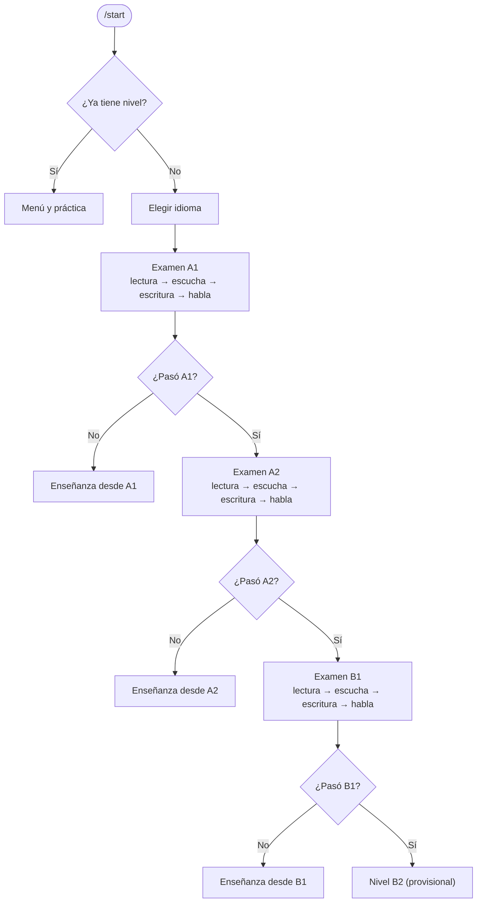

<div align="center">

# 🗣️ Tutor Inteligente de Idiomas

**Un tutor de idiomas en Telegram, con examen de nivel de lectura, escucha, escritura y habla**

Inglés 🇬🇧 y español 🇪🇸 · Proyecto de la materia *Sistemas Inteligentes*


[Wiki](https://github.com/DaniTap02/Tutor-idiomas-bot/wiki) ·
[Instalación](#-instalación) ·
[Examen](#-cómo-funciona-el-examen) ·
[Hoja de ruta](#-hoja-de-ruta)

</div>

---

## 📑 Contenido

- [Qué es](#-qué-es)
- [Estado del proyecto](#-estado-del-proyecto)
- [Cómo funciona el examen](#-cómo-funciona-el-examen)
- [Comandos](#-comandos)
- [Instalación](#-instalación)
- [Configuración](#%EF%B8%8F-configuración)
- [Ejecución y pruebas](#-ejecución-y-pruebas)
- [Estructura del proyecto](#-estructura-del-proyecto)
- [Diseño del agente (PEAS)](#-diseño-del-agente-peas)
- [Limitaciones actuales](#-limitaciones-actuales)
- [Hoja de ruta](#-hoja-de-ruta)
- [Ramas y contribuir](#-ramas-y-contribuir)

## 💡 Qué es

Es un chatbot de Telegram que funciona como tutor de idiomas personalizado (similar a Duolingo), enfocado inicialmente en **inglés y español**, con la posibilidad de un tercer idioma según el tiempo disponible.

Al primer contacto, el usuario realiza un **examen inicial** (lectura, escucha, escritura y habla) que determina su nivel de partida. A partir de ahí, el sistema entregará lecciones, ejercicios y retroalimentación adaptados a su desempeño, y enviará recordatorios de estudio.

> 📌 El tutor es una herramienta de apoyo al aprendizaje: no reemplaza a un docente ni equivale a una certificación oficial.

## 🚦 Estado del proyecto

| Fase | Descripción | Estado |
|---|---|---|
| 0 | Diseño y fundamentos | ✅ Completa |
| 1 | Esqueleto del bot | ✅ Completa |
| 2 | Examen de nivel funcional | 🔄 En curso: **A1, A2 y B1 listos** (lectura, escucha, escritura y habla); falta B2 |
| 3 | Tutor y contenido adaptativo | ⏳ Pendiente |
| 4 | Recordatorios, pulido y evaluación final | ⏳ Pendiente |

## 📝 Cómo funciona el examen

Al escribir `/start` por primera vez, el usuario elige idioma y rinde el examen empezando por A1. Si pasa un nivel, continúa con el siguiente; el examen se detiene en el primer nivel que **no** pasa.



### Contenido por nivel

| Parte | A1 | A2 | B1 |
|---|---|---|---|
| 📖 **Lectura** | 10 preguntas: 6 de gramática y 4 de vocabulario | 10 preguntas: 5 de gramática, 3 de vocabulario y 2 de **comprensión con mini-texto** (nota, cartel, mensaje o email corto) | 10 preguntas: 4 de gramática, 3 de vocabulario y 3 de **comprensión** con textos más largos (email, noticia, anuncio, blog o reseña) |
| 🎧 **Escucha** | 3 audios de 15 a 40 palabras con voz más lenta: mensajes, avisos o una presentación | 3 audios de 25 a 60 palabras: planes que cambian, avisos de estación, direcciones o un fin de semana | 3 audios de 45 a 90 palabras: un problema, una noticia, un relato con sentimientos o un consejo |
| ✍️ **Escritura** | Presentarte en 3 o 4 frases: nombre, de dónde eres y algo que te gusta | Mensaje a un amigo de 25 a 35 palabras sobre tu último fin de semana o vacaciones | Correo a un amigo de 50 a 70 palabras sobre un problema reciente: qué pasó, cómo te sentiste, qué hiciste y qué aprendiste |
| 🎤 **Habla** | Nota de voz de 15 a 30 s: nombre, dónde vives y algo que te gusta | Nota de voz de 30 a 45 s: tu rutina diaria y lo que vas a hacer este fin de semana | Nota de voz de 45 a 60 s: un viaje o experiencia que disfrutaste, por qué te gustó y qué harías la próxima vez |

### Cómo se evalúa

- **Lectura:** las preguntas las genera Ollama en cada examen. El código elige los temas permitidos del nivel, baraja las opciones y descarta las preguntas dudosas (formato, palabras prohibidas y una verificación del modelo que exige una única respuesta válida).
- **Escucha:** Ollama escribe un texto corto que alguien diría en voz alta y una pregunta sobre él, con los mismos filtros y la misma verificación que la lectura. El texto se convierte en audio con [edge-tts](https://github.com/rany2/edge-tts) y llega como nota de voz; el usuario solo lo **oye** y responde con botones. Puede repetir cada audio **una vez**, y al final del examen se le muestra lo que decía cada audio. Si no se pueden generar las preguntas, el examen sigue sin esta parte; si falla solo el audio, el bot envía el texto.
- **Escritura:** el calificador revisa el idioma, los requisitos de la tarea y los errores. El LLM solo responde preguntas simples; **el código aplica las reglas y calcula el puntaje**.
- **Habla:** la nota de voz se transcribe en local con [faster-whisper](https://github.com/SYSTRAN/faster-whisper), se comprueba que esté en el idioma del examen y se califica con el mismo calificador que la escritura. El bot muestra lo que entendió.
- **Aprobar un nivel:** cada parte (lectura, escucha, escritura y habla) debe sacar **al menos 60** y el promedio **al menos 70**.

> ℹ️ La transcripción comprueba que el usuario se hizo entender, pero **no mide la pronunciación fonética**. La comparación fonética sigue en la hoja de ruta.

Para agregar el examen de B2 hay que crear su archivo `questions_b2.py` (con el mismo formato que `questions_b1.py`), registrarlo en `BANCOS` dentro de `exam/telegram_flow.py` y agregar su configuración de escucha en `CONFIG` de `exam/listening.py`. El generador de preguntas adapta su estilo a cada nivel con atributos opcionales del banco, como `STYLE_HINT` y `PASSAGE_STYLE`.

### Práctica (español)

Fuera del examen, el bot ofrece ejercicios de opción múltiple:

- 5 ejercicios de gramática y vocabulario con tres opciones.
- Se responde escribiendo la palabra o el número de la opción (1, 2 o 3).
- La comparación ignora mayúsculas y tildes.
- Explicación después de cada respuesta, sea correcta o no.

<details>
<summary><b>➕ Cómo agregar ejercicios de práctica</b></summary>

```python
{
    "pregunta": "¿Cuál es el plural de «lápiz»?",
    "opciones": ["lápizes", "lápices", "lápizs"],
    "respuesta": "lápices",
    "explicacion": "Las palabras terminadas en -z cambian la z por c: lápiz → lápices.",
},
```

Cada ejercicio debe tener exactamente tres opciones, porque el bot acepta las respuestas numéricas 1, 2 y 3.

</details>

## 🤖 Comandos

| Comando | Descripción |
|---|---|
| `/start` | Inicia el examen si es la primera vez; si ya tiene nivel, muestra el menú |
| `/help` | Ayuda de uso |
| `/practicar` | Presenta un ejercicio aleatorio |
| `/siguiente` | Cambia a otro ejercicio |
| `/puntos` | Muestra respuestas correctas e incorrectas |
| `/reiniciar` | Solo para pruebas: borra el nivel y repite el examen |

## 📦 Instalación

**Requisitos**

- Python 3.10 o superior
- Una cuenta de Telegram y un token de bot creado con [@BotFather](https://t.me/BotFather)
- [Ollama](https://ollama.com/) con el modelo `qwen2.5:7b` (o el que configures con `OLLAMA_MODEL`)

**Pasos**

```bash
# 1. Clonar el repositorio
git clone https://github.com/DaniTap02/Tutor-idiomas-bot.git
cd Tutor-idiomas-bot

# 2. Crear y activar un entorno virtual
python -m venv .venv
# Windows (PowerShell)
.venv\Scripts\Activate.ps1
# Linux / macOS
source .venv/bin/activate

# 3. Instalar dependencias
pip install -r requirements.txt

# 4. Descargar el modelo de Ollama
ollama pull qwen2.5:7b
```

> ⏱️ La primera nota de voz tarda más: faster-whisper descarga su modelo (unos 500 MB con `small`).
>
> 🌐 Los audios de la escucha usan edge-tts, que **necesita internet** (igual que Telegram). Como respaldo, si tienes instalado `gTTS` (`pip install gTTS`) se usa cuando edge-tts falla. No necesitas ffmpeg.

## ⚙️ Configuración

1. Abre [@BotFather](https://t.me/BotFather) en Telegram, envía `/newbot` y sigue los pasos para obtener el token.
2. Crea un archivo `.env` en la raíz del proyecto:

```env
TELEGRAM_BOT_TOKEN=tu_token_aqui
```

**Variables opcionales**

| Variable | Descripción | Por defecto |
|---|---|---|
| `OLLAMA_URL` | Dirección del servidor de Ollama | `http://localhost:11434` |
| `OLLAMA_MODEL` | Modelo para generar preguntas y calificar | `qwen2.5:7b` |
| `WHISPER_MODEL` | Modelo de transcripción (`base` es más rápido, `small` más preciso) | `small` |
| `EXAM_WORKERS` | Preguntas generadas en paralelo (más puede saturar la RAM) | `1` |

> 🔒 **Seguridad:** `.env` ya está en `.gitignore`. No lo subas al repositorio ni lo compartas (por ejemplo, dentro de un `.zip`). Si el token se expone, revócalo con `/revoke` en @BotFather y genera uno nuevo.

## ▶️ Ejecución y pruebas

Con Ollama encendido:

```bash
python bot.py
```

Luego abre tu bot en Telegram y escribe `/start`. El bot usa *long polling*, por lo que no necesita servidor público ni webhook.

**Probar el examen sin Telegram**

```bash
python -m exam.test_a1
python -m exam.test_a2
python -m exam.test_b1
python -m exam.test_escucha          # escucha A1 en inglés
python -m exam.test_escucha B1 es    # escucha de otro nivel o idioma
```

Imprimen las preguntas generadas y califican textos de ejemplo. `test_escucha` genera las preguntas de escucha y guarda los audios en `audio_prueba/` para que los escuches y compruebes que la voz funciona, sin pasar por Telegram. Más detalles en `comandos_terminal.txt`.

## 🗂️ Estructura del proyecto

```
Tutor-idiomas-bot/
├── bot.py                     # Comandos, práctica y manejadores
├── exam/
│   ├── telegram_flow.py       # Flujo del examen: lectura, escucha, escritura y habla
│   ├── stt.py                 # Transcripción de notas de voz (faster-whisper)
│   ├── tts.py                 # Texto a voz para la escucha (edge-tts)
│   ├── listening.py           # Generación de preguntas de escucha y su configuración por nivel
│   ├── grader.py              # Calificador con Ollama (escritura y habla)
│   ├── question_generator.py  # Generación y verificación de preguntas de lectura
│   ├── placement.py           # Reglas para pasar de nivel
│   ├── questions_a1.py        # Temas, tareas y checklist del examen A1
│   ├── questions_a2.py        # Temas, tareas y checklist del examen A2
│   ├── questions_b1.py        # Temas, tareas y checklist del examen B1
│   ├── test_a1.py             # Prueba por terminal (A1)
│   ├── test_a2.py             # Prueba por terminal (A2)
│   ├── test_b1.py             # Prueba por terminal (B1)
│   └── test_escucha.py        # Prueba de la escucha: preguntas y audios
├── requirements.txt           # Dependencias
├── comandos_terminal.txt      # Guía para probar el examen
├── .env                       # Token de Telegram (no se versiona)
└── .gitignore                 # Excluye .env, .venv/, __pycache__/, *.pyc, datos_bot.pkl y audio_prueba/
```

<details>
<summary><b>🔍 Cómo funciona el código</b></summary>

**Flujo de escucha**

- Al terminar la lectura, `responder_lectura()` pasa a la parte `escucha`; las preguntas se generan al preparar el examen con `generate_listening()`.
- `_enviar_audio()` convierte el texto en `.mp3` con `synthesize()` (edge-tts, con una voz distinta según la pregunta y más lenta en A1) y lo envía como nota de voz.
- Los botones `lis:` registran la respuesta y `rep:` repite el audio (una vez por pregunta). El puntaje se guarda en `scores["escucha"]`.
- La configuración de cada nivel (número de audios, largo de los textos, velocidad y temas) está en `CONFIG` de `listening.py`.

**Flujo de voz**

- `telegram_flow.py` pasa de la escritura a la parte `habla` y envía la consigna del nivel.
- Cuando llega una nota de voz, `voz_de_examen()` la descarga a una carpeta temporal y llama a `transcribe()` en un hilo, para no congelar el bot.
- `transcribe()` devuelve el texto y el idioma detectado; si no coincide con el del examen, se pide repetir el audio. Los audios de menos de 8 segundos también se rechazan.
- El texto se califica con `grade(..., is_transcript=True)` y el checklist `speaking` del nivel; el puntaje se guarda en `scores["habla"]`.

**`bot.py`**

- `EJERCICIOS`: lista de diccionarios con `pregunta`, `opciones`, `respuesta` y `explicacion` (modo práctica).
- `normalizar()`: pasa el texto a minúsculas y elimina tildes para comparar respuestas.
- `responder()` atiende primero el examen (si está en curso) y, si no, compara la respuesta con la correcta.
- `voz()` envía las notas de voz al examen; fuera del examen avisa que aún no se usan.
- `main()` registra los manejadores y arranca el bot con `run_polling()`.

</details>

## 🧠 Diseño del agente (PEAS)

**Tipo de agente:** basado en utilidad, con aprendizaje. No reacciona con reglas fijas: evalúa el desempeño del usuario y modifica su comportamiento futuro (dificultad, contenido y ritmo de recordatorios) según el historial acumulado.

| Elemento | Descripción |
|---|---|
| **Entorno** | Chat de Telegram. El usuario interactúa por texto, voz y archivos multimedia. |
| **Desempeño** | Nivel inicial correcto, contenido acorde al nivel, conversación coherente, retroalimentación de errores, dificultad adaptativa, recordatorios y registro del progreso. |
| **Sensores** | Mensajes de texto, notas de voz, documentos e imágenes, respuestas de examen y ejercicios, horarios de recordatorio e historial en base de datos. |
| **Actuadores** | Aplicar el examen, asignar y actualizar el nivel, enviar lecciones y material, evaluar respuestas, ajustar la dificultad, registrar el progreso y enviar recordatorios. |

<details>
<summary><b>📈 Métricas, propiedades del entorno y desafíos</b></summary>

**Métricas de éxito:** precisión del examen inicial (nivel asignado frente a una referencia o autoevaluación), porcentaje de errores que no se repiten tras la retroalimentación, tasa de retorno tras un recordatorio y coherencia entre el desempeño y el ajuste de dificultad.

**Propiedades del entorno:** parcialmente observable, estocástico, secuencial, dinámico, discreto y de agente único.

**Desafíos principales:** precisión del examen en pronunciación (reconocimiento de voz y comparación fonética), comprensión de distintas formas de expresar una misma respuesta, evaluación de respuestas abiertas, coherencia conversacional, selección de contenido por nivel e idioma, y motivación del usuario a lo largo del tiempo.

</details>

### 📚 Documentación (wiki)

- [PEAS y tipo de agente](https://github.com/DaniTap02/Tutor-idiomas-bot/wiki/PEAS-y-tipo-de-agente)
- [Niveles y currículo](https://github.com/DaniTap02/Tutor-idiomas-bot/wiki/Niveles-y-curr%C3%ADculo)
- [Diseño del examen inicial](https://github.com/DaniTap02/Tutor-idiomas-bot/wiki/Dise%C3%B1o-del-examen-inicial)
- [Arquitectura técnica](https://github.com/DaniTap02/Tutor-idiomas-bot/wiki/Arquitectura-t%C3%A9cnica)
- [Roles del equipo](https://github.com/DaniTap02/Tutor-idiomas-bot/wiki/Roles-del-equipo)

## ⚠️ Limitaciones actuales

- Solo existen los exámenes de **A1, A2 y B1**. Al pasar B1, el nivel queda como B2 **provisional**.
- Si Ollama falla al preparar el examen de un nivel superior, el usuario queda en ese nivel (provisional) y puede repetir con `/reiniciar`.
- Con un modelo de 7B, las preguntas de B1 (condicionales, pasiva) son las más difíciles de generar y pueden tardar más.
- La práctica tiene solo 5 ejercicios y únicamente en español.
- El examen necesita **Ollama** encendido para generar preguntas y calificar.
- Los datos se guardan en un archivo local (`datos_bot.pkl`); todavía no hay base de datos ni historial de progreso.
- La parte de habla no evalúa la pronunciación fonética.
- La escucha necesita internet para generar el audio y usa voces sintéticas (inglés y español de Colombia).
- Aún no hay recordatorios.

## 🛣️ Hoja de ruta

- [x] Examen de nivel A1, A2 y B1 con lectura, escucha, escritura y habla
- [x] Notas de voz con reconocimiento de voz (STT) en el examen
- [x] `requirements.txt`
- [ ] Examen de B2
- [x] Parte de escucha: el bot envía audio (TTS) y el usuario responde
- [ ] Comparación fonética de la pronunciación
- [ ] Niveles y currículo por idioma (inglés y español)
- [ ] Contenido en inglés; tercer idioma opcional según el tiempo
- [ ] Tutor adaptativo que ajuste la dificultad según el desempeño
- [ ] Evaluación de respuestas abiertas y retroalimentación de errores
- [ ] Base de datos para el historial de progreso
- [ ] Recordatorios de estudio por Telegram con horario configurable
- [ ] Pruebas automatizadas

## 🌿 Ramas y contribuir

**Ramas**

- `main`: rama principal.
- `laura`: rama de trabajo.
- `jp-dev`: rama de trabajo.

**Contribuir**

1. Crea una rama a partir de `main`.
2. Haz tus cambios y confirma con mensajes claros.
3. Abre un Pull Request describiendo qué cambió y por qué.
