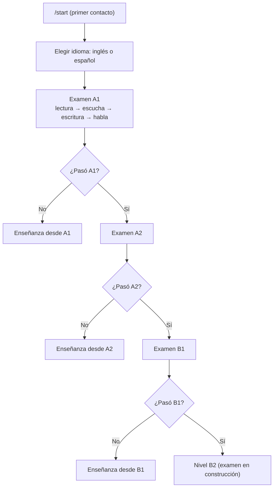

# Tutor Inteligente de Idiomas (Telegram Bot)

Proyecto de la materia **Sistemas Inteligentes**. Es un chatbot de Telegram que funciona como tutor de idiomas personalizado (similar a Duolingo), enfocado inicialmente en **inglés y español**, con la posibilidad de un tercer idioma según el tiempo disponible.

Al primer contacto con el bot, el usuario realiza un **examen inicial de nivel** con cuatro partes —**lectura, escucha, escritura y habla**— que determina su nivel de partida. A partir de ahí, el sistema entrega lecciones, ejercicios y retroalimentación adaptados a su desempeño, y envía recordatorios de estudio por Telegram.

> El tutor es una herramienta de apoyo al aprendizaje: no reemplaza a un docente ni equivale a una certificación oficial.

## Documentación (wiki)

- [PEAS y tipo de agente](https://github.com/DaniTap02/Tutor-idiomas-bot/wiki/PEAS-y-tipo-de-agente)
- [Niveles y currículo](https://github.com/DaniTap02/Tutor-idiomas-bot/wiki/Niveles-y-curr%C3%ADculo)
- [Diseño del examen inicial](https://github.com/DaniTap02/Tutor-idiomas-bot/wiki/Dise%C3%B1o-del-examen-inicial)
- [Arquitectura técnica](https://github.com/DaniTap02/Tutor-idiomas-bot/wiki/Arquitectura-t%C3%A9cnica)
- [Roles del equipo](https://github.com/DaniTap02/Tutor-idiomas-bot/wiki/Roles-del-equipo)

## Estado del proyecto

- [X] **Fase 0:** diseño y fundamentos
- [X] **Fase 1:** esqueleto del bot
- [ ] **Fase 2:** examen de nivel funcional — 🧪 **en pruebas**: A1, A2 y B1 con las cuatro partes (lectura, escucha, escritura y habla), en inglés y español. Falta B2.
- [ ] **Fase 3:** tutor y contenido adaptativo
- [ ] **Fase 4:** recordatorios, pulido y evaluación final

## Diseño del agente (resumen PEAS)

**Tipo de agente:** basado en utilidad, con aprendizaje. No reacciona con reglas fijas: evalúa el desempeño del usuario y modifica su comportamiento futuro (dificultad, contenido y ritmo de recordatorios) según el historial acumulado.

| Elemento | Descripción |
|---|---|
| **Entorno** | Chat de Telegram. El usuario interactúa por texto, voz y archivos multimedia. |
| **Desempeño** | Nivel inicial correcto, contenido acorde al nivel, conversación coherente, retroalimentación de errores, dificultad adaptativa, recordatorios y registro del progreso. |
| **Sensores** | Mensajes de texto, notas de voz, documentos e imágenes, respuestas de examen y ejercicios, horarios de recordatorio e historial en base de datos. |
| **Actuadores** | Aplicar el examen, asignar y actualizar el nivel, enviar lecciones y material, evaluar respuestas, ajustar la dificultad, registrar el progreso y enviar recordatorios. |

**Métricas de éxito:** precisión del examen inicial (nivel asignado frente a una referencia o autoevaluación), porcentaje de errores que no se repiten tras la retroalimentación, tasa de retorno tras un recordatorio y coherencia entre el desempeño y el ajuste de dificultad.

**Propiedades del entorno:** parcialmente observable, estocástico, secuencial, dinámico, discreto y de agente único.

**Desafíos principales:** precisión del examen en pronunciación (reconocimiento de voz y comparación fonética), comprensión de distintas formas de expresar una misma respuesta, evaluación de respuestas abiertas, coherencia conversacional, selección de contenido por nivel e idioma, y motivación del usuario a lo largo del tiempo.

## El examen de nivel

El examen se detiene en el primer nivel que **no** se aprueba. Si alguien pasa A2 pero no B1, queda en enseñanza de B1 hasta aprobarlo.



### Las cuatro partes

| Parte | Qué hace el estudiante | Cómo se califica |
|---|---|---|
| 📖 **Lectura** | Responde 10 preguntas de opción múltiple (gramática, vocabulario y comprensión con mini-textos). | Porcentaje de aciertos. |
| 🎧 **Escucha** | Oye 3 audios cortos (uno por pregunta) y responde con botones. Puede repetir cada audio una vez. | Porcentaje de aciertos. |
| ✍️ **Escritura** | Escribe un texto según la consigna del nivel. | El agente calificador revisa requisitos y errores. |
| 🎤 **Habla** | Envía una nota de voz según la consigna del nivel. | Se transcribe en local y el calificador revisa el contenido. |

**Aprobar un nivel:** cada parte evaluada debe sacar **al menos 60** y el promedio **al menos 70** (`exam/placement.py`). Si una parte no se puede evaluar (por ejemplo, la escucha falla porque no hay internet para generar los audios), **no se promedia**: nunca se penaliza al estudiante por un fallo del sistema.

### Las preguntas no están escritas a mano

No hay banco pregenerado. En cada examen, **Ollama redacta** las preguntas de lectura y los textos de escucha a partir de los temas permitidos del nivel, y el **código** elige el tema, baraja las opciones y decide cuál es la correcta.

Antes de mostrarse, cada pregunta pasa por tres controles (`exam/question_generator.py` y `exam/listening.py`):

1. **Filtros de código** (deterministas): formato, tres opciones distintas y cortas, solo alfabeto latino, largo máximo, palabras prohibidas del nivel, que la respuesta correcta no deje palabras repetidas (*"short short hair"*), que los temas que necesitan contexto lo traigan (`CONTEXT_TOPICS`) y que los pronombres con género tengan pista de género. En la escucha, además, nada que solo funcione **escrito**: paréntesis, comillas, enlaces, etiquetas de hablante (`Tom:`) o fórmulas de carta (*"Dear…"*, *"Atentamente"*), y la pregunta no puede hablar de «el texto» ni pedir leer.
2. **Verificación con el modelo** (una llamada, temperatura 0): debe haber **exactamente una** opción válida y ser la marcada como correcta; el contexto debe alcanzar; el nivel debe ser el adecuado; y en la escucha, la respuesta debe **decirse** en el audio y poder captarse oyendo una o dos veces.
3. **Evidencia citada y comprobada por código**: el modelo tiene que **copiar las palabras**, ya escritas en la pregunta o el texto, que hacen única la respuesta y descartan las otras. El código comprueba que esa cita exista de verdad. Si el modelo no puede señalar nada —porque no hay nada que señalar—, la pregunta es ambigua y se anula. Es lo que atrapa los casos clásicos:

   | Pregunta | Opciones | Qué pasa |
   |---|---|---|
   | `My brother is ___ than my sister.` | taller / younger / shorter | se anula: nada dice cuál |
   | `It is a ___ book.` | old / new / big | se anula: nada dice cuál |
   | `My brother is 10 and my sister is 15. My brother is ___ than my sister.` | younger / older / more young | pasa: las edades lo deciden |

Lo que no pasa se **anula**: no se le muestra al estudiante (no se le penaliza), se registra en `voided_questions.jsonl` y se genera otra. Para ver qué está fallando:

```bash
python -m exam.void_report              # todo
python -m exam.void_report listening    # solo la parte de escucha
```

### Dos agentes con responsabilidades separadas

| | **Validador de preguntas** | **Calificador de respuestas** |
|---|---|---|
| Archivos | `question_generator.py`, `listening.py` | `grader.py` |
| Cuándo actúa | **antes** de que exista el examen | cuando el estudiante ya respondió |
| Qué decide | si una pregunta es apta: respuesta única, contexto suficiente, nivel correcto, evidencia citada | si la respuesta abierta cumple la tarea y qué errores tiene |
| Qué NO hace | no ve respuestas de estudiantes | no arregla preguntas malas |

La calidad de las preguntas se garantiza **antes** de empezar el examen: el calificador no está ahí para tapar fallos del validador. Solo comparten el modelo de Ollama y el criterio de nivel.

El calificador **juzga el significado**, nunca compara con una respuesta esperada (de hecho no existe ninguna: las tareas de escritura y habla son abiertas). Acepta contracciones (*I'm* = *I am*), sinónimos, estructuras distintas y variantes regionales, y una errata que no cambie el sentido cuenta como error de ortografía pero **no** invalida el requisito. Cuando una respuesta está a medias, dice **qué falta y por qué**, en vez de marcarla incorrecta sin más.

### Audio: cómo funciona

- **Escucha (texto a voz):** `exam/tts.py` usa [edge-tts](https://pypi.org/project/edge-tts/) (voces neuronales de Microsoft), que **necesita internet**, igual que Telegram. Reintenta los fallos pasajeros y, si falla del todo y tienes instalado `gTTS`, lo usa como respaldo. edge-tts entrega `.mp3`, y la API de Telegram pide **OGG/OPUS** para una nota de voz, así que `exam/audio.py` convierte el mp3 con **PyAV** (llega con faster-whisper: **no necesitas ffmpeg**). Si la conversión no se puede hacer, el audio se envía como archivo de audio, que también es un formato aceptado.
- **Habla (voz a texto):** `exam/stt.py` usa [faster-whisper](https://pypi.org/project/faster-whisper/) **en local, sin internet** (salvo la primera descarga del modelo). El formato de Telegram no necesita conversión: PyAV lo decodifica. El idioma se **fuerza** al del examen: dejando que Whisper lo adivine, un acento marcado hablando inglés se detectaba como otro idioma y se rechazaba una respuesta correcta. Quién decide si el estudiante habló en el idioma pedido es el calificador, que juzga el **contenido**.
- Si no se puede generar un audio de la escucha, el examen muestra el texto escrito para no frenarse, lo anota en la revisión final y **esa pregunta no cuenta** en el puntaje de escucha: midió lectura, no escucha.

> **Importante:** la parte de habla califica **lo que se dijo**, no la pronunciación. La confianza de la transcripción solo se usa para pedir que grabe de nuevo cuando el audio no se entiende (ruido, micrófono lejano). La comparación fonética sigue en la hoja de ruta.

### Cuando el audio falla: el motivo real, no un mensaje genérico

Cada etapa del audio falla por separado y con su propia causa (`exam/registro.py`), así que el bot **no dice «¿tienes internet?» cuando el problema es otro**. Solo el motivo `red` significa que no se pudo conectar; un error del propio servicio, el reloj del PC desajustado o un rechazo de Telegram son motivos distintos, con mensajes distintos para el estudiante y con el error técnico original (tipo de excepción, mensaje y tiempos) en el registro.

| Parte | Motivos posibles |
|---|---|
| Texto a voz | `red` · `tiempo` · `reloj` · `servicio` · `corte` · `vacio` · `escritura` · `dependencia` |
| Conversión y archivos | `formato` · `convertir` · `archivo_vacio` · `archivo_falta` |
| Envío por Telegram | `envio` · `envio_prohibido` |
| Voz a texto | `dependencia` · `modelo_descarga` · `modelo_carga` · `memoria` · `transcripcion` · `sin_voz` |

Para saber qué pasa **en tu PC**, hay un comando que prueba cada componente por separado:

```bash
python -m exam.diagnostico          # entorno, dependencias, Ollama, texto a voz y voz a texto
python -m exam.diagnostico audio    # solo el audio
python -m exam.diagnostico ollama    # solo Ollama
```

Genera un audio de prueba, lo convierte, lo vuelve a transcribir (comprueba las dos partes de punta a punta) y, si algo falla, dice el motivo real y qué hacer. Los archivos y el registro técnico completo quedan en `diagnostico_audio/`. No imprime el token de Telegram ni ninguna clave.

## Estado actual del código

- **Examen de nivel** (`exam/`): A1, A2 y B1 con las cuatro partes, en inglés y español. B2 pendiente.
- **Prototipo de práctica** (`bot.py`): 5 ejercicios de opción múltiple en español (`/practicar`), que es lo que había antes del examen y queda como base de la fase 3.
- El nivel del usuario **sobrevive al reiniciar el bot** (`PicklePersistence` en `datos_bot.pkl`).

### Comandos

| Comando | Descripción |
|---|---|
| `/start` | Primera vez: lanza el examen de nivel. Después: menú con el nivel actual |
| `/reiniciar` | Borra el nivel y repite el examen (para pruebas) |
| `/help` | Ayuda de uso |
| `/practicar` | Presenta un ejercicio aleatorio de español |
| `/siguiente` | Cambia a otro ejercicio |
| `/puntos` | Muestra respuestas correctas e incorrectas de la sesión |

### Limitaciones actuales

- Falta el examen **B2**: quien pasa B1 queda en B2 *provisional*.
- La parte de habla no evalúa **pronunciación**, solo el contenido de lo que se dijo.
- Generar un examen completo con un modelo de 7B en un PC con 8 GB de RAM **tarda varios minutos**.
- Todavía no hay contenido de lecciones (fase 3), base de datos de progreso ni recordatorios.
- La puntuación de `/practicar` se guarda por sesión.

## Requisitos

- **Python 3.10 o superior** (probado con 3.13).
- Una cuenta de Telegram y un token de bot creado con [@BotFather](https://t.me/BotFather).
- [**Ollama**](https://ollama.com) corriendo en local con un modelo descargado (por defecto `qwen2.5:7b`):
  ```bash
  ollama pull qwen2.5:7b
  ollama list
  ```
- **Internet** para los audios de la escucha (edge-tts) y para Telegram. La transcripción del habla y Ollama funcionan sin internet.

## Instalación

```bash
# 1. Clonar el repositorio
git clone https://github.com/DaniTap02/Tutor-idiomas-bot.git
cd Tutor-idiomas-bot

# 2. Crear y activar un entorno virtual
python -m venv .venv
# Windows (PowerShell)
.venv\Scripts\Activate.ps1
# Linux / macOS
source .venv/bin/activate

# 3. Instalar dependencias
pip install -r requirements.txt
```

La primera nota de voz **descarga el modelo de Whisper** (unos 150 MB con el modelo `base`) y tarda más que las siguientes.

## Configuración

1. Abre [@BotFather](https://t.me/BotFather) en Telegram, envía `/newbot` y sigue los pasos para obtener el token.
2. Crea un archivo `.env` en la raíz del proyecto:

```env
TELEGRAM_BOT_TOKEN=tu_token_aqui
```

> **Seguridad:** `.env` ya está en `.gitignore`. No lo subas al repositorio ni lo compartas (por ejemplo, dentro de un `.zip`). Si el token se expone, revócalo con `/revoke` en @BotFather y genera uno nuevo.

### Variables de entorno opcionales

Todas tienen un valor por defecto que funciona; se ajustan si el PC va justo de recursos.

| Variable | Por defecto | Para qué |
|---|---|---|
| `OLLAMA_MODEL` | `qwen2.5:7b` | Modelo que redacta y califica (usa el tag de `ollama list`) |
| `OLLAMA_URL` | `http://localhost:11434` | Dirección de Ollama |
| `OLLAMA_NUM_CTX` | `2048` | Tamaño de contexto |
| `OLLAMA_TIMEOUT` | `120` | Segundos de espera por llamada |
| `EXAM_WORKERS` | `1` | Preguntas generadas en paralelo (más de 1 ahoga la RAM) |
| `EXAM_LISTENING_N` | el del nivel (3) | Cuántos audios de escucha; bájalo a `2` para probar más rápido |
| `EXAM_EXIGIR_EVIDENCIA` | `1` | Exige que el modelo cite qué descarta las otras opciones. `0` lo desactiva: genera más rápido pero deja pasar preguntas ambiguas |
| `EXAM_VOID_LOG` | `voided_questions.jsonl` | Dónde se registran las preguntas anuladas |
| `WHISPER_MODEL` | `base` | `tiny`, `base`, `small`, `medium`. `tiny` si el PC sufre; `small` si quieres más precisión |
| `WHISPER_DEVICE` | `cpu` | `cuda` si tienes GPU NVIDIA con VRAM suficiente |
| `WHISPER_COMPUTE` | `int8` | Precisión del modelo de voz |
| `WHISPER_BEAM` | `5` | Bájalo a `1` para transcribir más rápido |
| `TTS_TIMEOUT` | `40` | Segundos de espera por audio generado |
| `TTS_INTENTOS` | `3` | Reintentos con edge-tts antes de pasar al respaldo |
| `TTS_NOTA_VOZ` | `1` | `0` para no convertir a OGG/OPUS y enviar siempre el mp3 como archivo de audio |

## Ejecución

```bash
python bot.py
```

Luego abre tu bot en Telegram y escribe `/start`. El bot usa *long polling*, por lo que no necesita servidor público ni webhook.

> El bot **no puede correr en dos computadores a la vez** con el mismo token: Telegram da un error de conflicto. Apaga uno antes de encender el otro.

## Pruebas

Cinco pruebas **no necesitan internet, ni Ollama, ni el modelo de Whisper**: simulan el modelo y Telegram, y `test_audio` trabaja con archivos de audio reales que crea PyAV. Son 218 comprobaciones y tardan unos segundos.

```bash
python -m exam.test_validacion            # filtros y validación de la LECTURA
python -m exam.test_escucha_validacion    # filtros y validación de la ESCUCHA
python -m exam.test_calificador           # el calificador de escritura y habla
python -m exam.test_audio                 # conversión, sondeo y motivos de error del audio
python -m exam.test_flujo                 # el examen completo simulado de punta a punta
```

Las demás sí usan Ollama (y la de escucha, internet para el audio):

```bash
python -m exam.test_a1                    # preguntas y calificador de A1
python -m exam.test_a2
python -m exam.test_b1
python -m exam.test_escucha               # escucha A1 en inglés
python -m exam.test_escucha B1 es         # otro nivel u otro idioma
```

`test_escucha` guarda los `.mp3` en `audio_prueba/` para que los escuches y compruebes que se entienden, sin pasar por Telegram. Más detalles en `comandos_terminal.txt`.

## Estructura del proyecto

```
Tutor-idiomas-bot/
├── bot.py                          # Comandos, ejercicios de práctica y registro de manejadores
├── exam/
│   ├── telegram_flow.py            # Flujo del examen: lectura → escucha → escritura → habla
│   ├── question_generator.py       # Genera y VALIDA las preguntas de lectura con Ollama
│   ├── listening.py                # Genera y valida los textos de escucha + su configuración por nivel
│   ├── grader.py                   # Agente calificador de escritura y habla (Ollama)
│   ├── tts.py                      # Texto a voz para la escucha (edge-tts, respaldo gTTS)
│   ├── stt.py                      # Voz a texto del habla (faster-whisper, en local)
│   ├── audio.py                    # Sondeo de archivos y conversión a nota de voz (PyAV)
│   ├── registro.py                 # Motivos de error, registro con etapas y tiempos, sin secretos
│   ├── diagnostico.py              # Prueba cada componente y dice qué falla en tu PC
│   ├── placement.py                # Reglas de aprobación y a qué nivel pasa
│   ├── questions_a1.py             # Banco A1: temas, prohibidos, consignas y checklists
│   ├── questions_a2.py             # Banco A2
│   ├── questions_b1.py             # Banco B1 (varias tareas de escritura, temas propios en español)
│   ├── void_report.py              # Resumen de las preguntas anuladas
│   ├── test_validacion.py          # Pruebas de la lectura (sin Ollama)
│   ├── test_escucha_validacion.py  # Pruebas de la escucha (sin Ollama)
│   ├── test_calificador.py         # Pruebas del calificador (sin Ollama)
│   ├── test_audio.py               # Pruebas del audio con archivos reales (sin internet)
│   ├── test_flujo.py               # Prueba del examen completo (sin Telegram ni Ollama)
│   ├── test_a1.py / test_a2.py / test_b1.py   # Pruebas con Ollama
│   ├── test_escucha.py             # Prueba de la escucha con audios reales
│   ├── RESUMEN_A2.txt / B1.txt     # Alcance de cada nivel, en texto
│   └── RESUMEN_AUDIO.txt           # Cómo quedaron la escucha y el habla
├── requirements.txt
├── comandos_terminal.txt           # Guía de comandos paso a paso
├── voided_questions.jsonl          # Registro de preguntas anuladas (se va llenando solo)
├── .env                            # Token de Telegram (no se versiona)
└── README.md
```

### Agregar el nivel B2

1. Crear `exam/questions_b2.py` con el mismo formato que `questions_b1.py`.
2. Registrarlo en `BANCOS`, dentro de `exam/telegram_flow.py`.
3. La configuración de escucha de B2 **ya está** en `CONFIG`, en `exam/listening.py`.

El generador adapta su estilo a cada nivel con los atributos opcionales del banco (`GEN_STYLE`, `PASSAGE_SHAPE`, `FORBIDDEN_RE`, `CONTEXT_TOPICS`…), documentados al inicio de `exam/question_generator.py`.

### Agregar ejercicios de práctica

```python
{
    "pregunta": "¿Cuál es el plural de «lápiz»?",
    "opciones": ["lápizes", "lápices", "lápizs"],
    "respuesta": "lápices",
    "explicacion": "Las palabras terminadas en -z cambian la z por c: lápiz → lápices.",
},
```

Cada ejercicio debe tener exactamente tres opciones, porque el bot acepta las respuestas numéricas 1, 2 y 3.

## Hoja de ruta

- [X] Examen inicial de nivel con lectura, escucha, escritura y habla.
- [X] Validación de preguntas: nada ambiguo, fuera de nivel o sin contexto llega al estudiante.
- [X] Notas de voz con reconocimiento de voz (STT) en local.
- [X] Niveles y currículo A1, A2 y B1 por idioma (inglés y español).
- [ ] Examen B2.
- [ ] Comparación fonética para evaluar pronunciación.
- [ ] Tutor adaptativo que ajuste la dificultad según el desempeño.
- [ ] Contenido de lecciones por nivel e idioma; tercer idioma opcional según el tiempo.
- [ ] Base de datos para el historial de progreso.
- [ ] Recordatorios de estudio por Telegram con horario configurable.

## Ramas

- `main`: rama principal.
- `laura`, `jp-dev`: ramas de trabajo del equipo.

## Contribuir

1. Crea una rama a partir de `main`.
2. Haz tus cambios y confirma con mensajes claros.
3. Abre un Pull Request describiendo qué cambió y por qué.
