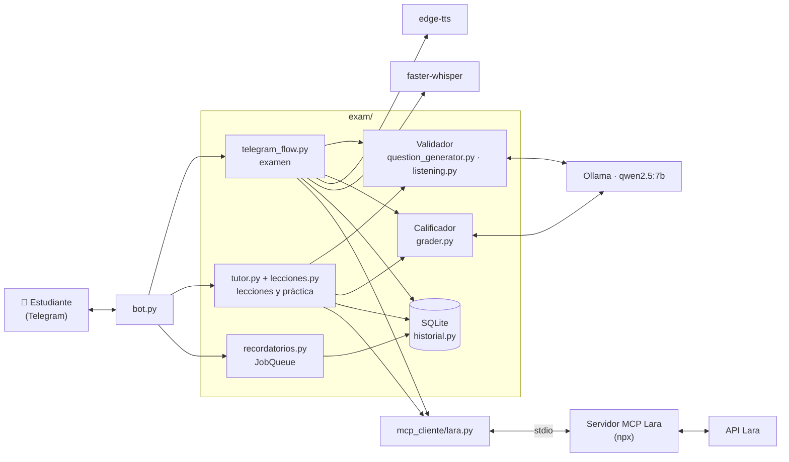

# Arquitectura técnica

Todo corre en un PC modesto (8 GB de RAM): el modelo es **qwen2.5:7b por Ollama en local**, la transcripción es **faster-whisper en local** y la base de datos es **SQLite** de la librería estándar. Los únicos servicios por internet son Telegram, edge-tts (audios de la escucha) y Lara Translate (MCP).

## Componentes

| Componente | Archivo | Responsabilidad |
|---|---|---|
| Bot | `bot.py` | Registra comandos y botones, anota al usuario en cada mensaje, abre la sesión de Lara y reprograma los recordatorios al arrancar. |
| Examen | `exam/telegram_flow.py` | Lectura → escucha → escritura → habla por nivel. Guarda el nivel por idioma. |
| Validador | `exam/question_generator.py`, `exam/listening.py` | Genera cada pregunta con Ollama y la valida: filtros de código, verificación con el modelo y evidencia citada. Lo anulado va a `voided_questions.jsonl`. |
| Calificador | `exam/grader.py` | Juzga el significado de la escritura y el habla con un checklist; el código calcula el puntaje. |
| Tutor | `exam/tutor.py`, `exam/lecciones.py` | 5 lecciones por nivel e idioma: explicación generada, ejercicios validados, escritura corta. Repite temas fallados y avanza con rachas. |
| Bancos | `exam/questions_a1.py` … `questions_b2.py` | Temas permitidos con su alcance, prohibidos del nivel, consignas y checklists (inglés y español). |
| MCP | `mcp_cliente/lara.py`, `exam/traduccion.py` | Cliente MCP de Lara: `detect_language` antes de calificar y `translate` para `/traducir` y el botón Ver traducción. |
| Historial | `exam/historial.py`, `exam/metricas.py` | SQLite: examen por parte, ejercicios, lecciones, errores por tipo, uso de Lara, actividad. Métricas del PEAS. |
| Recordatorios | `exam/recordatorios.py` | `/recordatorio HH:MM` con la JobQueue de python-telegram-bot (America/Bogota), guardados en SQLite. |
| Audio | `exam/tts.py`, `exam/stt.py`, `exam/audio.py` | Texto a voz (edge-tts), voz a texto (Whisper) y conversión a nota de voz (PyAV). |
| Errores | `exam/registro.py` | Motivo real de cada falla (audio, Lara), sin secretos en el registro. |

## MCP: Lara Translate

- El bot es un **cliente MCP** (SDK oficial de Python `mcp`). El servidor es el oficial de Lara (`@translated/lara-mcp`) y corre en local por **stdio**: `npx -y @translated/lara-mcp@2.2.0`, con Node.js 22.23.4 o superior.
- **Una sola sesión** durante toda la vida del bot. La abre una tarea "dueña", porque el SDK usa anyio y la sesión se abre y se cierra en la misma tarea. Tiene tiempo de espera, un reintento corto y caché de traducciones.
- Del servidor (22 herramientas) se usan exactamente **dos**:
  - `detect_language({"text"})` → `{"language": "en-US", "predictions": [...]}`;
  - `translate({"text": [{"text"}], "source", "target"})` → `{"items": [{"text"}]}`.
- Credenciales en `.env` (`LARA_ACCESS_KEY_ID`, `LARA_ACCESS_KEY_SECRET`). Sin ellas, sin Node o sin cuota, el bot sigue: la detección se salta y `/traducir` dice que no está disponible.

## Principio de diseño: nunca penalizar por fallas del sistema

| Falla | Qué hace el bot |
|---|---|
| Ollama no genera una pregunta válida | Se anula, se registra y se genera otra. En las lecciones se avisa y no cuenta. |
| No se puede generar un audio | Se muestra el texto y esa pregunta no cuenta en la escucha. |
| La escucha entera falla | El nivel se promedia sin esa parte. |
| Whisper falla varias veces | El nivel se cierra sin la parte de habla. |
| Lara no responde | La detección se salta y decide el calificador. |
| La base SQLite falla | Se registra y el bot sigue. |

## Pruebas

`python -m pytest` corre todas las pruebas **sin Telegram, sin internet, sin Ollama y sin Lara**, con dobles de cada servicio. `test_niveles_simulados.py` recorre los 4 niveles en los 2 idiomas y las 40 lecciones con un Ollama simulado y el validador real. Los scripts `test_a1`, `test_b2 lectura`, `test_es`, `test_escucha` y `mcp_cliente/probar_lara` usan los servicios reales.
